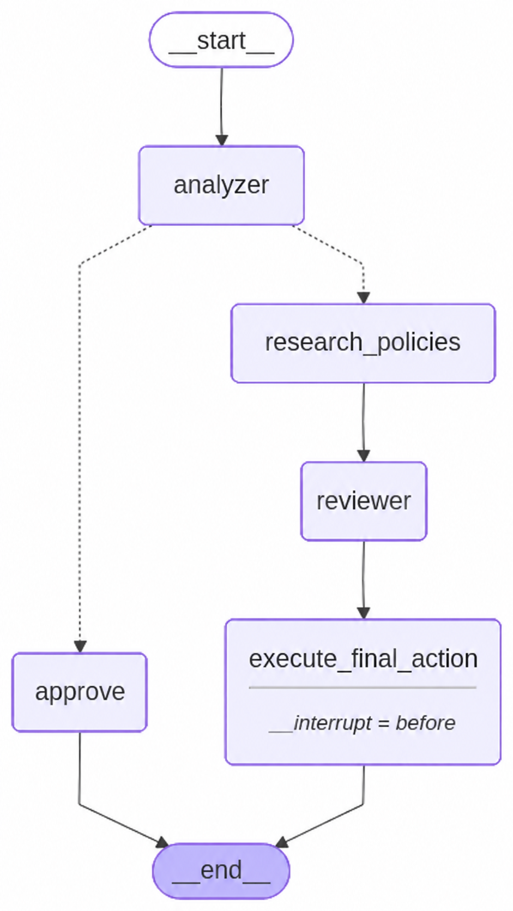

<<<<<<< HEAD
# 评论审核智能体

这是一个基于 **LangGraph** 和 **Streamlit** 构建的人工智能评论审核系统，支持人工参与审核：对于被识别为存在问题的评论，审核员可以在确认最终结果之前查看、修改或推翻人工智能的建议。



## 功能特点

- 自动分析评论，将其分为正面、中性或存在问题三类。
- 识别评论违反的社区规则。
- 提供批准、删除或编辑的审核建议。
- 对存在问题的评论暂停处理，等待人工审核。
- 提供交互式网页界面和当前会话的审核历史。
- 通过兼容 OpenAI 的远程接口调用 `qwen3.8-max` 模型，完成评论分析、规则匹配和审核建议生成。

程序界面和示例评论均使用简体中文，模型被要求使用简体中文生成分析和审核理由。代码标识及内部状态值保留英语，页面将状态显示为中文。当前版本记录审核结果，尚未接入外部平台的评论删除或修改接口。

## 智能体流程

```text
输入评论 → 分析评论
             ├─ 未发现问题 → 自动批准
             └─ 发现问题 → 匹配社区规则 → 生成审核建议 → 人工审核 → 记录最终结果
```

## 技术组成

| 技术 | 用途 |
|---|---|
| [LangGraph](https://github.com/langchain-ai/langgraph) | 编排智能体工作流，支持暂停与恢复 |
| [Streamlit](https://streamlit.io) | 构建网页界面 |
| `qwen3.8-max` | 通过远程模型服务提供评论审核能力 |
| LangChain | 集成模型并管理提示词 |

## 环境要求

- 安装 Python；当前项目的本地虚拟环境已使用 Python 3.13.5 完成依赖安装和页面初始化检查。
- 能够访问已配置的远程模型服务：`https://cn-beijing.maas.qianwenaiapi.com/compatible-mode/v1`。
- 配置该服务的有效接口密钥，并确保对应账号有权调用 `qwen3.8-max`。
- 当前配置无需安装本地模型运行工具或下载模型权重；调用额度和费用以所用服务的账号配置为准。

## 安装方法

获取项目源码；如果已经下载，可以跳过克隆步骤：

```bash
git clone https://github.com/carlosMartinez93/comment-moderation-agent.git
cd comment-moderation-agent
```

在项目根目录创建虚拟环境并安装依赖。

### 在 Windows 中安装

在 PowerShell 中执行：

```powershell
python -m venv .venv
.\.venv\Scripts\python.exe -m pip install -r requirements.txt
```

### 在 Linux 或 macOS 中安装

```bash
python3 -m venv .venv
./.venv/bin/python -m pip install -r requirements.txt
```

以上命令直接使用虚拟环境中的解释器，无需先激活虚拟环境。当前这份项目已经创建 `.venv` 并安装依赖，可以直接启动。

## 使用方法

1. 确认 `load_model()` 中的远程服务地址、接口密钥和模型标识 `qwen3.8-max` 已正确配置，且网络能够访问该服务。
2. 在项目根目录运行应用。

Windows 的 PowerShell 命令：

```powershell
.\.venv\Scripts\python.exe -m streamlit run v_final_agente.py
```

Linux 或 macOS 命令：

```bash
./.venv/bin/python -m streamlit run v_final_agente.py
```

3. 在浏览器中打开 [本地审核页面](http://localhost:8501)。
4. 输入评论或选择示例，然后点击分析按钮。
5. 如果人工智能检测到问题，将显示人工审核面板。可以确认建议、取消建议并强制批准，或修改状态和理由后确认。
6. 在页面下方查看当前会话的审核历史。停止程序时，在终端按 `Ctrl+C`。

## 模型配置

当前模型配置位于 `v_final_agente.py` 的 `load_model()` 函数中：

| 配置项 | 当前值 |
|---|---|
| 服务地址 | `https://cn-beijing.maas.qianwenaiapi.com/compatible-mode/v1` |
| 模型标识 | `qwen3.8-max` |
| 接口密钥 | 由模型服务提供的有效密钥，通过 `api_key` 参数传入；本文档不展示密钥内容 |
| 采样温度 | `0` |

程序通过 `ChatOpenAI` 客户端访问兼容 OpenAI 的接口。当前 `base_url`、`api_key` 和 `model` 均在 `load_model()` 中显式配置。程序虽然会加载项目根目录的 `.env` 文件，但仅修改环境变量不会覆盖这些显式参数；需要调整配置时，请修改该函数中的对应参数。

## 项目结构

```text
comment-moderation-agent/
├── v_final_agente.py    # 主程序，包含智能体工作流和网页界面
├── moderation_workflow.png  # 智能体流程图
├── requirements.txt    # 依赖清单
├── .venv/              # 本地虚拟环境，不纳入版本控制
├── .gitignore          # 版本控制忽略规则
└── README.md           # 项目说明
```

## 审核规则

1. **垃圾广告**：禁止发布与课程无关的外部链接。
2. **冒犯性语言**：删除辱骂或人身攻击内容。
3. **无关内容**：标记偏离当前课程主题的评论。
4. **虚假信息**：删除关于课程内容的虚假陈述。
5. **尊重他人**：批评应具有建设性，禁止攻击学生或讲师。

## 许可证

本项目声明采用 MIT 许可证。
=======
# comment-moderation-agent
>>>>>>> 52f81459212931f0e7fa0dc537c60d38c5973a00
